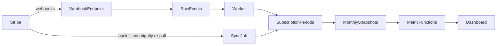

# Tallyway Revenue Dashboard

A one-page dashboard that lets Tallyway's CEO answer three questions every Monday in under a minute:

1. **Are we growing?** Monthly recurring revenue and its trend.
2. **Are we keeping the customers we have?** Customer churn and net revenue retention.
3. **Where is the problem?** Which plan and which cohort is slipping.

All data is mock data generated in the codebase. Nothing connects to Stripe.

## Running it

Requires Node.js 20.9 or later (developed on Node 22).

```bash
npm install
npm run dev      # http://localhost:3000
npm test         # metric unit tests
npm run lint
npm run build && npm start
```

No environment variables are needed.

## What's on the page

| Feature | Question it answers |
| --- | --- |
| Headline cards: MRR, customer churn, NRR, new paying customers, each against last month | Is this month better or worse? |
| MRR trend by plan, stacked Pro and Enterprise bars | Is growth coming from Pro or Enterprise? |
| Cohort retention table, with the weakest cohort called out | Are newer customers leaving faster than older ones? |
| Plan and date range filters that drive every number above | Where exactly is the problem? |

Headline cards show the last month of the selected range against the month before it. Delta colours reflect whether the change is good (rising churn is red, rising MRR is green), and every ratio's numerator and denominator are printed under it so a number can be checked by eye.

## Metric definitions

Each definition is one function in `lib/metrics`, tested in `lib/metrics/metrics.test.ts`.

- **MRR**: the total monthly price of every active paid subscription at month end. Free counts as $0. Annual plans count as the yearly price divided by 12.
- **Customer churn**: customers paying at the start of the month (end of the previous month) who are not paying at the end of it, divided by customers paying at the start.
- **Net revenue retention**: MRR this month from customers who were paying 12 months ago (zero for those who left), divided by their MRR back then.
- **New paying customers**: customers whose first paying month is this month, including upgrades from Free.
- **Cohort**: all customers who first became paying in the same month. Each cell is the percent of the cohort paying at the end of that later month.

### Assumptions

- **Annual Enterprise price**: the brief gives only $399 per month, so annual is $4,788 per year (12 x $399). This is set in one constant in `lib/domain/plans.ts`.
- **Moving to Free counts as cancelling**: the customer stops paying, so they count in churn and drop out of "still paying". Switching between Pro and Enterprise is not churn.
- **Plan filter**: All plans, Pro, Enterprise. Free is left out because every metric is about paying customers. Under a plan filter:
  - MRR and churn use the plan the customer was on in that month.
  - NRR uses the plan they were on 12 months ago and counts their MRR today on any plan, so Pro upgrades to Enterprise show as expansion.
  - New paying customers and cohorts use the customer's first paid plan.
- **Date range**: any span within the last 12 complete months. The MRR chart shows the range; cohorts that first paid in the range are followed up to its last month.
- **Reporting period**: complete calendar months, through Oct 31, 2026.
- **Weakest cohort callout**: the cohort whose latest retention is furthest below the average of all cohorts at the same month, shown only when it is at least 5 points below and at least 3 cohorts are comparable.

## Mock data

`lib/data/mock-customers.ts` simulates about 800 customer records from January 2024 to October 2026, about 500 of them active at the end, with a seeded random generator so every render produces identical data. It includes Free-to-paid conversions, Pro-to-Enterprise upgrades, downgrades, and annual Enterprise contracts that can only cancel at renewal. Pro customers who first paid from April 2026 onward cancel much faster than earlier ones, which is the problem the dashboard is meant to surface.

## Project structure

```
app/                      Route: page.tsx renders the dashboard
components/dashboard/     Dashboard (client, filter state), FilterBar, HeadlineCards, MrrTrendChart, CohortTable
components/ui/            Card, StatCard, DeltaPill, EmptyState
lib/domain/               Types, plans, and prices
lib/data/                 Seeded generator and mock customer ledger
lib/metrics/              One pure function per metric, plus tests
lib/format.ts             Currency, percent, and delta formatting
```

The page is a static Server Component that passes the ledger to one Client Component. Filters recompute every metric in the browser with `useMemo`, so changes are instant. That is fine for one company with a few hundred customers; see Scale below for what changes beyond that.

## Design

### Data flow

Stripe stays the system of record for billing. A webhook endpoint receives subscription and invoice events, verifies the Stripe signature, and stores each raw event once, keyed by Stripe's event id. A worker applies those events to the subscription history tables. Events can arrive late or out of order, so the worker re-reads the current subscription from the Stripe API instead of trusting arrival order. A one-time backfill loads existing subscriptions through the API, and a nightly job re-pulls them to catch anything a webhook missed. A snapshot job then writes one row per customer per month, and the dashboard reads those rows through the same metric functions this build runs on mock data.



### Data model

- `stripe_events`: raw event payloads, append-only. This is the audit trail, and it lets history be rebuilt if a metric definition changes.
- `customers`: one row per Stripe customer.
- `prices`: plan, billing interval, and amount. Prices are rows rather than constants, so a price change does not rewrite history.
- `subscription_periods`: one row per stretch of time a customer spent on one price, with start and end dates. This is the source of truth for every metric, and it has the same shape as the mock ledger in this repo (`lib/domain/types.ts`).
- `customer_month_snapshots`: one row per customer per month with plan, MRR, and a paying flag at month end. MRR, churn, NRR, and cohorts become simple group-bys over this table, and closed months stop moving.

### Accuracy

In this build, each term in the brief has exactly one function in `lib/metrics`, every number on the page goes through those functions, and unit tests check them against a small fixture whose answers were worked out by hand (`npm test`). In production I would add:

- Idempotent ingestion keyed by Stripe event id, so retried webhooks never double count.
- A nightly reconciliation that compares the dashboard's active subscriptions and MRR with Stripe's own figures and flags any gap.
- Invariant checks on every snapshot run: plan MRR sums to total MRR, every cohort starts at 100%, cancelled customers never exceed starting customers.
- Closed months frozen once reported, with any restatement logged, and a "data through" date on the page so a stalled pipeline is visible.

### Scale

Volume is not the hard part: 50 companies of Tallyway's size is about 25,000 customers. What changes is isolation and onboarding.

- Every table gets an account id with row-level security, and sign-in with per-company access becomes necessary.
- Each company connects its own Stripe account (Stripe Connect or a restricted API key). Webhooks and backfills are queued per account, so one large import cannot delay the others.
- Plans, prices, and currency become per-company data instead of constants.
- Metrics are computed on the server from snapshots instead of in the browser. Shipping the whole ledger to the client only works at one small company's size.
